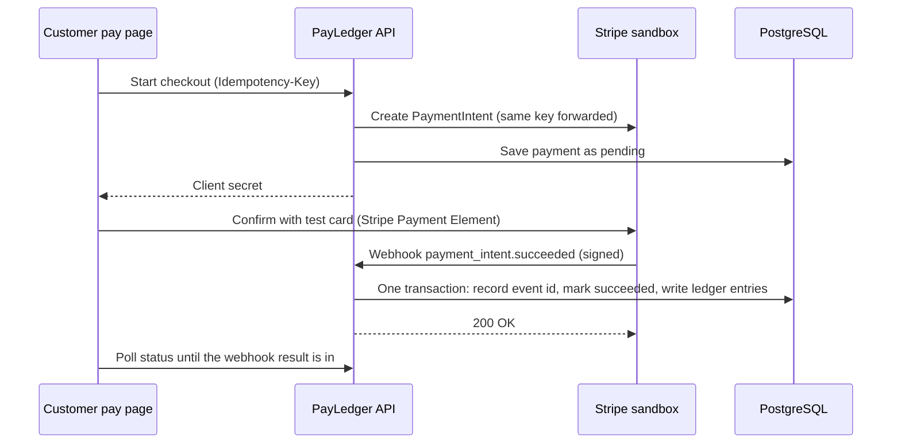

# PayLedger


PayLedger is a small merchant payments service: a TypeScript/Node API that takes card payments through Stripe's sandbox and records every cent in a double-entry ledger, plus a React dashboard for merchants and a pay page for their customers. The goal was to get the hard parts of payments right (retries, duplicate webhooks, out-of-order events, refunds that race each other) rather than to build a lot of features.

<!-- Add dashboard + pay page screenshots to docs/ and link them here -->

## How a payment flows

The browser never decides whether a payment succeeded. Stripe's signed webhook does, and the ledger entries are written in the same database transaction that records it.



## How money is kept correct

**Integer cents.** Every amount is an integer number of cents, in the API, the database and the dashboard (dollar input is parsed as a string, never through a float).

**Idempotency keys.** Every POST needs an `Idempotency-Key` header. The key row is inserted at the start of the same database transaction that does the work, with a hash of the request. A second request with the same key blocks on the primary key until the first one commits, then gets the saved response back byte for byte. The same key with a different body gets a 422. If the work crashes, the whole transaction rolls back (key included) so the retry runs for real. The key is also forwarded to Stripe, so a retry after a rollback gets the same PaymentIntent instead of a second one.

**Verified webhooks.** `/webhooks/stripe` reads the raw request bytes (JSON parsing is turned off for that route only) and checks Stripe's signature. Bad signatures get a 400.

**Duplicate and out-of-order webhooks.** The Stripe event id is inserted into `webhook_events` first; a repeat delivery conflicts and does nothing. Status changes go through a state machine, so a late `processing` can't drag a `succeeded` payment backward. Refund events use Stripe's running total (`amount_refunded`), so an older event arriving late has nothing new to add.

**Double-entry ledger.** Each money movement is a ledger transaction with entries that sum to zero. A $25 payment is `stripe_clearing +2500` and `merchant_payable −2500`; a $10 refund reverses $10. Balances are always summed from entries, never stored. The database backs this up on its own:

- a deferred constraint trigger rejects any transaction whose entries don't sum to zero at commit
- another trigger blocks `UPDATE` and `DELETE` on `ledger_entries`, so mistakes get fixed with new reversing entries
- each ledger transaction has a unique business ref (`capture:<paymentId>`, `refund:<refundId>`), so the same movement can't be booked twice even if something slipped past the webhook dedupe

**Refund races.** Creating a refund locks the payment row (`SELECT … FOR UPDATE`), so two refunds that together exceed the payment run one after the other and the second is rejected.

## Running it locally

You need Node 22, Docker (Colima works on a Mac) and the Stripe CLI.

```bash
brew install node colima docker stripe/stripe-cli/stripe
colima start
docker compose up -d            # Postgres, plus a payledger_test database for tests
npm install

cp api/.env.example api/.env    # fill in your sandbox keys
cp web/.env.example web/.env
npm run db:migrate -w api
```

In a second terminal, forward Stripe webhooks to your machine. It prints a `whsec_...` secret; put that in `api/.env` as `STRIPE_WEBHOOK_SECRET`. (It's a different secret from the one in the Stripe dashboard, and mixing them up is the usual reason signature checks fail.)

```bash
stripe login
stripe listen --forward-to localhost:3000/webhooks/stripe
```

Then start both apps:

```bash
npm run dev -w api    # http://localhost:3000
npm run dev -w web    # http://localhost:5173
```

Sign up, make a pay link, open it, and pay with 4242 4242 4242 4242. The dashboard picks up the payment within a few seconds.

To replay a webhook and watch nothing change, find the event in `stripe listen` output and run `stripe events resend evt_...`; the API logs `outcome: "duplicate"` and the balance stays the same.

## Tests

```bash
npm test     # 61 API tests against a real Postgres
npm run lint
npm run typecheck
```

The API tests use the real Stripe library to sign webhook payloads and a fake for the two outbound Stripe calls (create PaymentIntent, create refund), which acts like Stripe for repeated idempotency keys. After every single test, a hook checks that every ledger transaction sums to zero and that each merchant's balance equals captured payments minus succeeded refunds.

What they cover:

| Area | Examples |
| --- | --- |
| Idempotency | 10 concurrent creates with one key make exactly 1 payment and 10 identical responses; same key + different body is 422; a Stripe failure saves nothing and the retry goes through |
| Webhooks | tampered body / wrong secret / no header are 400; the same event 5 times (in a row and at once) books once; `succeeded` then `processing` stays succeeded; failed card then successful retry |
| Refunds | two racing refunds that exceed the payment: one 201, one 422; partial then full refund; a stale `charge.refunded` changes nothing; a failed refund frees the amount; a refund made in the Stripe dashboard still lands in the ledger |
| Ledger | unbalanced transactions refused in code and by the database; entries can't be updated or deleted; same ref posts once |
| Auth and API | hashed passwords, token checks, one error shape, merchants can't see each other's payments |

### End-to-end test

`e2e/pay.spec.ts` drives the pay page in a real browser with the 4242 card and checks the dashboard API afterward. It needs the API, the web app and `stripe listen` running with sandbox keys:

```bash
npx playwright install chromium
RUN_E2E=1 ADMIN_TOKEN=<your admin token> npm run e2e
```

## CI/CD

GitHub Actions runs lint, type-check, the API tests against a Postgres service container, and both builds on every pull request. Branch protection on `main` requires that check to pass, and every change goes in through a PR using the template in `.github/` (money in cents? idempotent? errors handled?).

`render.yaml` defines a Render deploy (API web service + static dashboard) with a Neon database; I've run it locally with the Stripe CLI forwarding webhooks.

## API

All money is in cents. Merchant routes need `Authorization: Bearer <token>`; POSTs need `Idempotency-Key`.

| Method | Path | |
| --- | --- | --- |
| POST | `/v1/merchants` | sign up |
| POST | `/v1/auth/login` | log in |
| GET | `/v1/me` | current merchant |
| POST | `/v1/payments` | create a payment (returns a Stripe client secret) |
| GET | `/v1/payments` | list, `?status=` filter |
| GET | `/v1/payments/:id` | payment with its refunds and ledger entries |
| POST | `/v1/payments/:id/refunds` | partial or full refund |
| GET | `/v1/balance` | balance computed from the ledger |
| GET | `/v1/ledger` | ledger transactions with entries |
| POST / GET | `/v1/pay-links` | create / list pay links |
| GET | `/v1/public/pay-links/:token` | what the pay page shows (no login) |
| POST | `/v1/public/pay-links/:token/checkout` | start a checkout from a link (no login) |
| GET | `/v1/public/payments/:token` | status the pay page polls (no login) |
| GET | `/v1/admin/ledger-check` | invariant report, needs `x-admin-token` |
| POST | `/webhooks/stripe` | Stripe webhooks |

Webhook events handled: `payment_intent.processing`, `payment_intent.succeeded`, `payment_intent.payment_failed`, `charge.refunded`, `charge.refund.updated`, `refund.created`, `refund.updated`, `refund.failed`.

Errors always look like `{ "error": { "code": "refund_exceeds_payment", "message": "...", "details": { ... } } }`.

## Layout

```
payledger/
├── api/
│   ├── src/routes/     auth, payments + refunds, pay links, webhooks, admin
│   ├── src/services/   payment/refund logic and the webhook handler
│   ├── src/ledger/     posting, balances, invariant check
│   ├── src/lib/        idempotency, payment state machine, Stripe gateway
│   ├── src/db/         Drizzle schema, client, migrator
│   ├── drizzle/        SQL migrations (including the ledger triggers)
│   └── test/
├── web/
│   ├── src/dashboard/  login, payments, payment detail, pay links
│   └── src/pay/        customer pay page
├── e2e/                Playwright pay-page test
├── docker-compose.yml
├── render.yaml
└── .github/            CI workflow + PR template
```

## Known limits

- Sandbox only: the API refuses to start with anything but an `sk_test_` key.
- Stripe fees aren't modeled; the ledger tracks gross amounts.
- The Stripe call to create a PaymentIntent happens inside the database transaction that holds the idempotency key. That keeps retries simple and exact, at the cost of holding a connection during a network call. At real scale I'd split it into a "started" row committed first, then the Stripe call, then the result.
- Opening a pay link starts a checkout (and a pending PaymentIntent) right away, so abandoned visits leave pending payments behind. Reloading reuses the same one.
